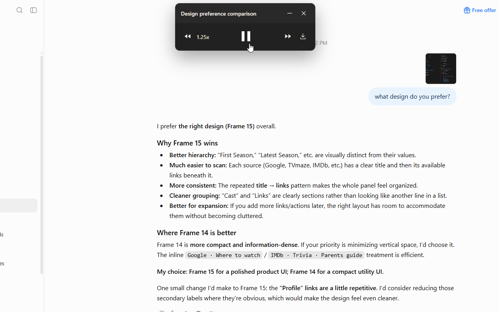

# chatgpt-audio-player

Audio player for the 'Read Aloud' feature

# DESCRIPTION:

This extension adds audio player controls when an Audio element is being played with the 'Read Aloud' feature of ChatGPT.

# HOW IT WORKS:

It tracks audio elements when they play, and detects Web Audio contexts used for playback, including in accessible frames. A floating player appears while audio is playing or paused. It lets you play or pause, change playback speed, and download captured 'Read Aloud' audio. The player can also be moved, minimized, or dismissed.

# SEEK BAR AND DURATION:

This extension used to display a seekbar and a duration timestamp. I had to temporarily hide that functionality, as ChatGPT makes frequent changes to how they deliver the audio, making the seekbar functionality fragile.  
Right now the focus is on providing a stable and reliable way to pause/resume the audio.